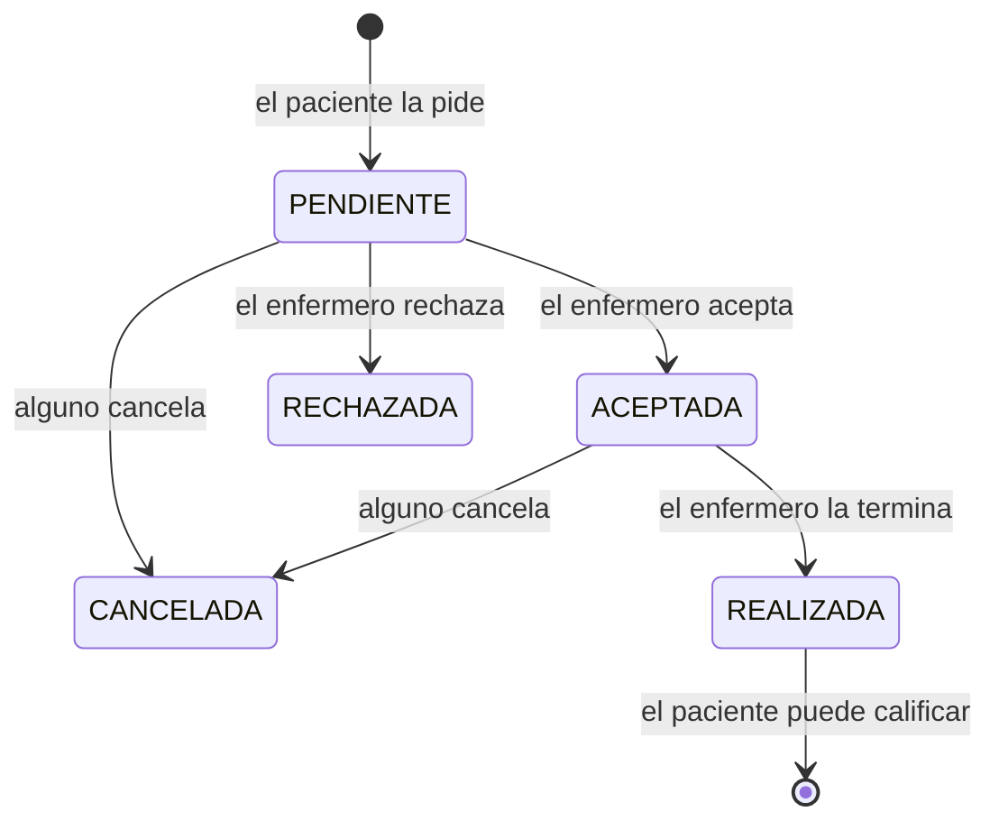
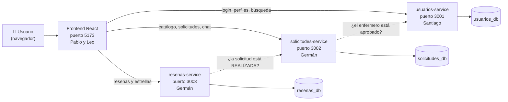

# Enfered explicado fácil

Esta guía explica **qué vamos a construir y cómo**, sin dar nada por sabido. Leela entera una vez (son 10 minutos) y después usá [TAREAS_GRUPO.md](TAREAS_GRUPO.md) como referencia técnica para tu parte.

---

## 1. ¿Qué es Enfered?

Es una página web que **conecta pacientes con enfermeros/as que atienden a domicilio**, en la provincia de **Mendoza**. Pensalo como *PedidosYa o Uber, pero de enfermería*:

- Alguien necesita, por ejemplo, que le apliquen una inyección en su casa.
- Entra a Enfered, **busca enfermeros cerca de su domicilio**, elige uno, le **pide el servicio** para un día y hora.
- El enfermero **acepta**, se **escriben por chat** para coordinar, va a la casa, y al final el paciente lo **califica con estrellas**.

¿Qué problema resuelve? Hoy esto se hace por "boca a boca" o grupos de WhatsApp: no sabés si el enfermero está matriculado, tarda en conseguirse y no hay opiniones de otros pacientes. En Enfered **solo aparecen enfermeros con la matrícula validada** por un administrador.

---

## 2. Los 3 tipos de usuario

| Usuario | Qué puede hacer |
|---|---|
| 🧑 **Paciente** | Registrarse, buscar enfermeros cerca, pedir un servicio, cancelarlo, chatear con el enfermero, calificarlo cuando termina |
| 👩‍⚕️ **Enfermero/a** | Registrarse con su matrícula, cargar qué servicios ofrece y dónde atiende, aceptar o rechazar pedidos, chatear, marcar el servicio como realizado |
| 🛠️ **Admin** | Aprobar o rechazar la matrícula de cada enfermero, administrar usuarios y el catálogo de servicios |

Un enfermero que se registra **no aparece en las búsquedas hasta que el admin aprueba su matrícula**.

---

## 3. Un pedido de punta a punta (ejemplo)

Ana necesita un control de glucemia. Laura es enfermera.

| # | Qué pasa | Pantalla (front) | Quién lo resuelve (back) |
|---|---|---|---|
| 1 | Laura se registra como enfermera con su matrícula. Queda **pendiente** | Registro (Pablo) | usuarios-service (Santiago) |
| 2 | El admin revisa la matrícula y la **aprueba** | Panel admin (Pablo) | usuarios-service (Santiago) |
| 3 | Laura carga en su perfil los servicios que ofrece y su zona | Mi perfil (Pablo) | usuarios-service (Santiago) |
| 4 | Ana se registra como paciente e inicia sesión | Login / Registro (Pablo) | usuarios-service (Santiago) |
| 5 | Ana busca "Control de glucemia" cerca de su casa y ve a Laura en la lista y en el mapa, con su distancia y sus estrellas | Buscar enfermeros (Leo) | usuarios-service (Santiago) + resenas-service (Germán) |
| 6 | Ana le pide el servicio para el jueves a las 10. La solicitud queda **PENDIENTE** | Solicitar servicio (Leo) | solicitudes-service (Germán) |
| 7 | Laura ve el pedido en su bandeja y lo **ACEPTA** | Bandeja del enfermero (Leo) | solicitudes-service (Germán) |
| 8 | Se escriben por **chat** para coordinar la dirección (el chat ya estaba abierto desde el paso 6) | Chat (Leo) | solicitudes-service (Germán) |
| 9 | Laura va, hace el control y marca la solicitud como **REALIZADA** | Bandeja del enfermero (Leo) | solicitudes-service (Germán) |
| 10 | Ana le deja **5 estrellas** y un comentario | Mis solicitudes → Calificar (Leo) | resenas-service (Germán) |

Los estados de una solicitud son siempre estos:



El chat funciona mientras la solicitud está **PENDIENTE** o **ACEPTADA**: así el paciente puede consultar antes de que el enfermero acepte. Cuando la solicitud se cierra, queda para leer.

---

## 4. Cómo está armado por dentro

La app tiene **dos mitades**:

- **Frontend** (lo que se ve): una página hecha en **React**. Corre en el navegador.
- **Backend** (lo que no se ve): guarda los datos y aplica las reglas. Está partido en **3 microservicios** hechos en **NestJS**, cada uno con su propia base de datos en **MongoDB**.



### ¿Por qué 3 servicios y no uno solo?

Porque la consigna pide **microservicios**: programas chicos e independientes, cada uno con una sola responsabilidad. Si uno se cae, los otros siguen andando, y cada integrante puede trabajar en el suyo sin pisar a los demás.

| Servicio | De qué se encarga | Cómo se le habla |
|---|---|---|
| **usuarios-service** | Cuentas, login, perfiles, búsqueda por cercanía, validación de matrículas | REST |
| **solicitudes-service** | Catálogo de servicios (inyección, curación…), los pedidos y sus estados, el chat | REST + **GraphQL** (catálogo) |
| **resenas-service** | Las calificaciones y el promedio de estrellas de cada enfermero | **GraphQL** |

La consigna pide **dos CRUD con GraphQL**: son el **catálogo de servicios** y las **reseñas**.

---

## 5. ¿Cómo se conectan las partes?

### El login y el "token"

Cuando alguien inicia sesión, usuarios-service le da un **token** (JWT): un texto largo que dice *"este es el usuario 123, es PACIENTE"*, firmado con una clave secreta (`JWT_SECRET`).

Funciona como la **pulsera de un boliche**: te la ponen en la entrada (login) y después la mostrás en cada barra (cada pedido al backend) sin volver a hacer la fila. Los otros dos servicios **confían en la pulsera** porque conocen la misma clave secreta y pueden comprobar que no es trucha.

El front guarda el token y lo manda en cada pedido en el header `Authorization: Bearer <token>`.

### Los roles

Cada ruta del backend dice quién puede usarla. Eso lo hacen los **guards**, que son como "patovicas":

- **JwtAuthGuard**: "¿tenés pulsera válida?". Si no, responde **401**.
- **RolesGuard**: "¿tu pulsera es del color correcto?". Por ejemplo, solo un ADMIN aprueba matrículas. Si no, responde **403**.

Santiago arma los guards y los pasa a Germán, que los usa en sus dos servicios.

### El contrato

Para que el front y el back encajen, **todos respetamos lo mismo**: los nombres de las rutas, los campos de cada dato, los roles y los códigos de error. Eso está en la sección 2 de [TAREAS_GRUPO.md](TAREAS_GRUPO.md). Gracias a eso, Pablo y Leo pueden armar las pantallas **con datos de prueba** antes de que el back esté terminado, y después solo cambian la dirección.

---

## 6. Qué hace cada uno

| Integrante | Parte | Lo primero que tiene que hacer |
|---|---|---|
| **Santiago** | **usuarios-service** (login, roles, perfiles, búsqueda, admin) + **docker-compose** + scripts de la base de datos + límite de intentos en el login | El **login y los guards**: todos los demás dependen de eso. Subirlos el **jueves 30** |
| **Germán** | **solicitudes-service** (catálogo ✅, solicitudes, chat) + **resenas-service** | Las solicitudes y el chat |
| **Pablo** | **Base del front** a partir del de PP3: capa de API, login y registro, perfil, panel admin, componentes + **todos los tests del front** | Copiar el front de PP3, **borrar lo que no va y adaptar la capa de API**: Leo depende de eso |
| **Leo** | **Pantallas principales** adaptadas del front de PP3: búsqueda con mapa, perfil del enfermero, pedir servicio, mis solicitudes, bandeja, chat, calificar + **README y documento** | Adaptar búsqueda, solicitudes y chat a la API nueva, **con datos de prueba** si el back no está |

Además, **cada uno hace el `Dockerfile` de lo suyo** y en sus servicios pone `helmet` (seguridad).

El detalle de cada tarea, los tests y los nombres exactos están en la sección 3 de [TAREAS_GRUPO.md](TAREAS_GRUPO.md).

---

### ¿Hacemos todo de cero?

- **El backend sí**: la consigna pide NestJS, MongoDB y microservicios, y la Enfered de PP3 estaba en Flask. Del código de PP3 solo tomamos **las reglas** (qué se valida, qué está permitido), no el código.
- **El frontend no**: el de PP3 ya usa React + Vite + axios + react-router + react-leaflet, justo lo que pide el TP, y tiene casi todas las pantallas. **Lo copiamos y lo adaptamos a este contrato**: se cambia la capa que le habla al backend y se **borra** lo que no existe en el TP (pagos, notificaciones, IA, etc.). En el README lo aclaramos.

### ¿Cómo se ve?

Todo el front sigue **la misma identidad visual**: colores, tipografía, botones, colores por estado y versión para celular. Está en la **sección 2.11 de [TAREAS_GRUPO.md](TAREAS_GRUPO.md)**. Así la app parece hecha por una sola persona y no por cuatro. Los textos van **en voseo**: "Buscá", "Iniciá sesión", "Tenés".

---

## 7. Cómo trabajar todos los días

```bash
# La primera vez
git clone https://github.com/GermanTornello/Parcial_programacion_enf.git
cd Parcial_programacion_enf

# Cada vez que te sentás a trabajar
git checkout <tu-rama>          # santi, pablo, leo o german
git pull origin main            # traés lo último que se juntó en main

# Cuando terminás algo (aunque sea chico)
git add .
git commit -m "Qué hiciste, en español"
git push origin <tu-rama>
```

- Cada uno trabaja **solo en su carpeta**: `backend/usuarios-service`, `backend/solicitudes-service`, `frontend`, etc.
- **Subí lo que hagas todos los días**, aunque no esté terminado: así el resto ve el avance.
- Cuando algo funciona, se abre un **Pull Request a `main`** y otro del grupo le da un vistazo.
- Si necesitás cambiar algo del contrato, **avisá en el grupo antes**.

### Trabajar con la IA

Pasale a la IA **este archivo y [TAREAS_GRUPO.md](TAREAS_GRUPO.md)** y escribile: *"Soy [tu nombre]. Ayudame a hacer mi parte respetando exactamente el contrato"*. Así no inventa nombres de rutas o campos que después no encajan con lo de los demás.

---

## 8. Fechas

| Fecha | Objetivo |
|---|---|
| **Miércoles 29/10** | Todos arrancan su parte y suben lo que tengan |
| **Jueves 30/10** | **Santiago sube login, roles y guards.** Pablo copia el front de PP3 y adapta la capa de API |
| **Viernes 31/10** | Juntamos todo: el front usa el back de verdad. Cada uno sube su Dockerfile y **probamos `docker compose up --build`** |
| **Sábado 1/11** | Tests y arreglos |
| **Domingo 2/11** | README, documento y prueba completa desde cero |
| **Lunes 3/11** | **Entrega** |

---

## 9. Glosario

| Palabra | Qué significa |
|---|---|
| **Frontend** | La parte que ve el usuario (pantallas, botones). Acá: React |
| **Backend** | La parte que no se ve: guarda datos y aplica reglas. Acá: NestJS |
| **Microservicio** | Un programa chico e independiente que hace una sola cosa. Tenemos 3 |
| **API** | La "ventanilla" por la que el front le pide cosas al back |
| **REST** | Una forma de API: cada cosa tiene una dirección (`/solicitudes`) y una acción (GET para leer, POST para crear, PATCH para cambiar, DELETE para borrar) |
| **GraphQL** | Otra forma de API: el front pide exactamente los campos que quiere, todo por una sola dirección (`/graphql`) |
| **CRUD** | Crear, Leer, Actualizar y Borrar (Create, Read, Update, Delete) |
| **MongoDB** | La base de datos. Guarda los datos como "documentos" parecidos a JSON |
| **JWT / token** | La "pulsera" que te da el login para demostrar quién sos en cada pedido |
| **Guard** | El "patovica" de cada ruta: controla que tengas token y el rol correcto |
| **401 / 403 / 404 / 409** | Errores: sin login / sin permiso / no existe / dato repetido |
| **Swagger** | Página automática (`/docs`) que documenta y deja probar la API REST |
| **Docker** | Empaqueta cada parte para que todo el proyecto arranque igual en cualquier compu con un solo comando |
| **Mock / datos de prueba** | Datos inventados con la forma real, para avanzar sin esperar al back |
| **Test unitario** | Prueba una función sola. **Test e2e**: prueba un recorrido completo (por ejemplo, registrarse y loguearse) |
